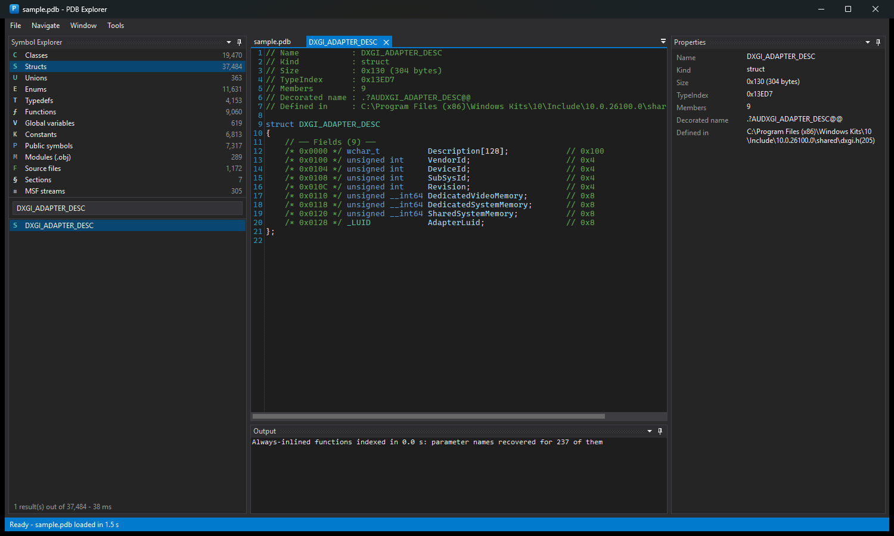
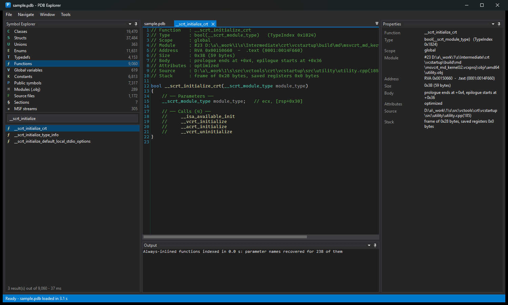

# PDB Explorer

A Windows desktop app that opens a Microsoft PDB and shows what is in it as readable pseudo-C++:
classes with their layout, functions with their parameters and locals, global variables, modules,
source files, sections and the raw MSF streams.

It reads the PDB itself (no DIA SDK, no `msdia140.dll`), maps the file instead of loading it, and
stays usable on multi-gigabyte PDBs. It has been used on PDBs up to 4.3 GB.





## What you get

- **Types** – classes, structs, unions and enums as a header: base classes, fields with offset and
  size, bitfields, static members, nested types, methods with `virtual` / `override` / `static` /
  `const`, vtable slots, and the header file and line that defines the type.
- **Functions** – signature, address, size, the module and source line, parameters and locals with
  their register or stack location, nested scopes, inlined calls (with their code offsets) and the
  functions called.
- **Parameter names** – taken from the function's own symbols. For methods that were always inlined
  and have no symbol, the names are recovered from the inline sites where they were expanded.
- **Everything else** – global variables, typedefs, constants, public symbols, modules (`.obj`),
  source files, PE sections, MSF streams, and a summary page for the PDB.
- **Navigation** – every type or function name in a document is a link. Ctrl+Click or F12 opens it,
  Ctrl+- goes back.
- **Search** – case-insensitive substring search in the selected category. It runs in parallel over
  the whole table, so it answers as you type even with millions of names.
- **Export** – the current document, a class as `.h` + `.cpp`, the items listed in the explorer, or
  the whole PDB.
- Dark and light themes, English and French.

## Build

Requirements: Windows 10 or 11 (x64) and the [.NET 10 SDK](https://dotnet.microsoft.com/download).

```
dotnet build -c Release
```

The executable is `bin\Release\net10.0-windows\PdbExplorer.exe`.

## Use

Start the app and open a PDB with **File > Open PDB** (Ctrl+O), drop one onto the window, or pass it
on the command line:

```
PdbExplorer.exe C:\path\to\program.pdb
```

Pick a category on the left, type part of a name, and double-click a result (or press Enter).

### Shortcuts

They follow Visual Studio's defaults.

| Shortcut | Action |
| --- | --- |
| Ctrl+O | Open a PDB |
| Ctrl+T, Ctrl+E, Ctrl+, | Go to symbol (focus the search box) |
| Ctrl+F | Find in the document |
| F12, Ctrl+Click | Go to definition |
| Ctrl+-, Alt+Left | Back |
| Ctrl+Shift+-, Alt+Right | Forward |
| Ctrl+F4, Ctrl+W | Close the tab |
| Ctrl+Tab, Ctrl+PageDown | Next tab |
| Ctrl+Shift+Tab, Ctrl+PageUp | Previous tab |
| Ctrl+S | Export the document |
| Ctrl+Shift+E | Export the class (`.h` + `.cpp`) |
| Ctrl+Shift+S | Export everything |
| Esc | Cancel a running export |

### Export everything

**File > Export everything** writes three folders:

```
Types\       one header per original header file, in the original folder tree
             (types without source information go to _NoSourceInfo\A.h ... Z.h)
Functions\   one .cpp per module, named 0042_Something.cpp
Globals\     GlobalVariables.h, Typedefs.h, Constants.h, PublicSymbols.txt
```

On a large PDB this is a lot of text: expect several gigabytes and a long run. A file that cannot be
written is skipped and counted, the export carries on.

### Command line

Both commands run without the window and print to the console.

```
PdbExplorer.exe --export-all <pdb> <folder>
PdbExplorer.exe --selftest <pdb> [type] [function]
```

`--selftest` loads the PDB, renders one type and one function, runs a few searches and a small
export, and returns a non-zero exit code if a check fails. The type and function default to
`AActor` and `AActor::BeginPlay` (Unreal Engine); pass names that exist in your PDB otherwise.
There is no separate test project; this is what was used to check the reader against real PDBs.

### Settings

**Tools > Options** changes the language, the theme, the editor font size and line numbers, and
whether parameter names of inlined functions are indexed after loading. They are saved in
`%AppData%\PdbExplorer\settings.json`.

## How it works

```
Pdb\         the reader
  MsfStream          a stream of the MSF container, read through a memory-mapped view
  PdbFile*.cs        PDB info, DBI (modules, files, sections), TPI/IPI, symbols, line tables
  TypeRecords.cs     typed views over CodeView type records
  SymbolRecords.cs   typed views over CodeView symbol records
  SymbolTable.cs     names of one category in a single UTF-8 buffer, sorted, searchable
Rendering\   turns a type, function, module... into a Document (text + colored, linked segments)
Export\      writes documents to disk
Cli\         --export-all and --selftest
UI\          the WPF window (AvalonDock for the layout, AvalonEdit for the documents)
```

Nothing is parsed into an object graph up front. Loading builds the name tables and a few indexes;
records are decoded from the mapped file when a document is rendered. On a 4.3 GB PDB the app's own
memory is about 1.6 GB, almost all of it name tables and indexes; the rest of what Task Manager
shows is the mapped file, which Windows can drop at any time.

Record layouts and names follow `cvinfo.h` from
[microsoft/microsoft-pdb](https://github.com/microsoft/microsoft-pdb) and the
[LLVM PDB documentation](https://llvm.org/docs/PDB/index.html).

## Limitations

- MSF 7.00 PDBs only. The old 2.0 container and portable (.NET) PDBs are not supported.
- Only tested with x64 PDBs.
- `LF_CLASS2` / `LF_STRUCTURE2` records are listed but not decoded.
- Functions are described, not decompiled: the PDB has no code, only symbols.
- The pseudo-C++ is meant to be read. It will not compile as is.

## Dependencies

- [AvalonEdit](https://github.com/icsharpcode/AvalonEdit) (MIT)
- [AvalonDock](https://github.com/Dirkster99/AvalonDock) and its VS2013 theme (Ms-PL)

## License

[MIT](LICENSE)


## Credit

Made by Claude: Fable 5.2 (ehh mercéé)